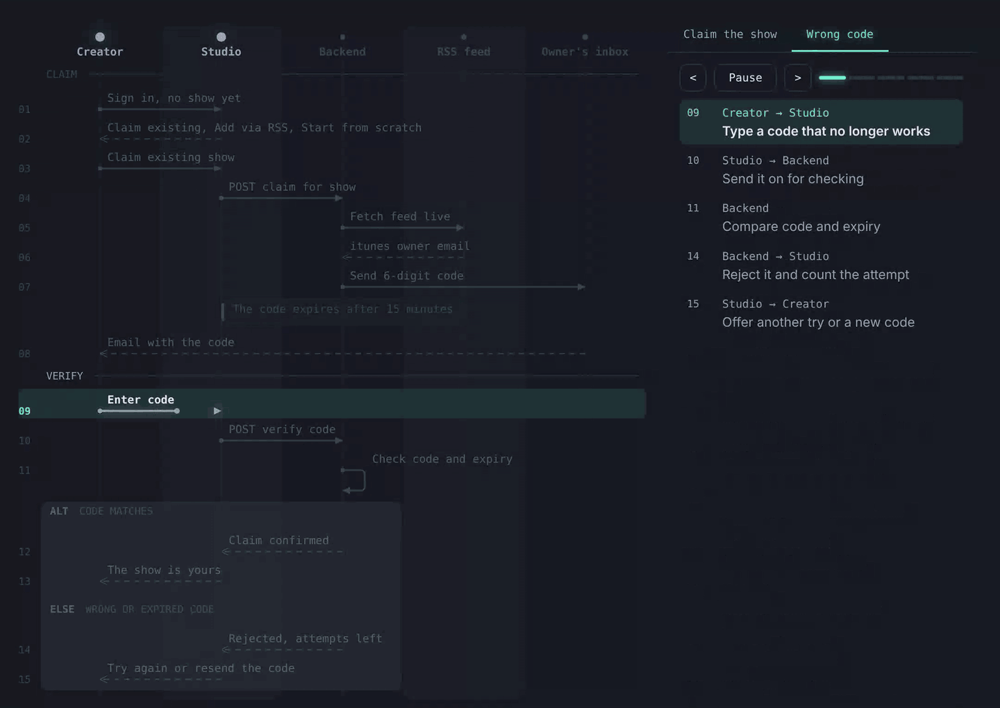

# ablauf

**Diagrams that agents write as text and people read as figures.**

[](https://www.npmjs.com/package/@uberblick/ablauf)
[](https://github.com/uberblick-ai/ablauf/blob/main/LICENSE)
[](https://github.com/uberblick-ai/ablauf/blob/main/package.json)
[](https://ablauf.uberblick.ai)

ablauf is a small text format for diagrams and the renderer that draws it as
themed SVG. The author decides where each step sits and which side each edge
leaves and enters, so a small edit leaves the rest of the picture where it
was. The renderer never moves anything; it reports every problem with its
line number, so an agent can check a diagram without seeing it.

<picture>
  <source media="(prefers-color-scheme: dark)" srcset="https://raw.githubusercontent.com/uberblick-ai/ablauf/main/docs/images/source-dark.png">
  
</picture>

## Three kinds

Routed flows, outcome fan-outs and sequences of messages, in light and dark,
with your own colours through `--ab-*` custom properties.

<picture>
  <source media="(prefers-color-scheme: dark)" srcset="https://raw.githubusercontent.com/uberblick-ai/ablauf/main/docs/images/kinds-dark.png">
  
</picture>

## Playback

A `play` section after a flow walks the reader through it step by step, in
one or more scenarios, with captions. It lives in the same text, so it fits in
a Markdown code block.


The second scenario in the GIF, written under the Dependabot flow:

```
play "Tests failing"
  step dependabot actor="Dependabot files" "Bump zod from 4.4.3 to 4.6.6"
  step dependencies
  step integrator 2.4s actor="Integrator" "A test fails, so it gets one fix round"
  step needs-changes
  step implementer actor="Implementer" "Fixes two assertions; a reviewer checks the fix"
  step integrator actor="Integrator" "Tests pass now"
  step merged
```

In a page, one call adds the scenario tabs, the buttons, the step bar and the
caption under the figure:

```javascript
import { render } from "@uberblick/ablauf";
import { mountPlayback } from "@uberblick/ablauf/playback";

const { svg, timelines } = render(source, { idPrefix: "dependabot" });
figure.innerHTML = svg;
// autoplay: play while the figure is in view
mountPlayback(figure, figure.querySelector("svg"), timelines, { autoplay: true });
```

Sequences use the same `play` sections, with each step targeting a message by
its number. Fan-out playback is still to come.

The “Wrong code” scenario from `claim-play.flow`:

```
play "Wrong code"
  step 9 "Type a code that no longer works"
  step 10 "Send it on for checking"
  step 11 "Compare code and expiry"
  step 14 "Reject it and count the attempt"
  step 15 "Offer another try or a new code"
```



## Install

Requires Node.js 22.18 or newer.

Install it in your project:

```sh
npm install @uberblick/ablauf
```

Save this as `render-flow.mjs`:

```js
import { readFile, writeFile } from "node:fs/promises";
import { render } from "@uberblick/ablauf";

const [input, output] = process.argv.slice(2);
if (!input || !output) {
  console.error("Usage: node render-flow.mjs input.flow output.svg");
  process.exit(2);
}

const source = await readFile(input, "utf8");
const { svg, diagnostics } = render(source, {
  idPrefix: "build-flow",
  scheme: "light",
});
await writeFile(output, svg);

for (const { line, severity, message } of diagnostics) {
  console.error(`${input}:${line} ${severity}: ${message}`);
}
// Keep the SVG for inspection, but fail the build on any source problem.
process.exitCode = diagnostics.length ? 1 : 0;
```

Run it with a flow file and the desired output path:

```sh
node render-flow.mjs diagram.flow diagram.svg
```

Playback, options and themes are in [the API docs](https://github.com/uberblick-ai/ablauf/blob/main/docs/api.md) and
[host page themes](https://github.com/uberblick-ai/ablauf/blob/main/docs/theming.md).

## Learn more

- [ablauf.uberblick.ai](https://ablauf.uberblick.ai): every kind with its source.
- [The primer](https://github.com/uberblick-ai/ablauf/blob/main/spike/PRIMER.md): the whole format on one page, for agents.
- [Motivation](https://ablauf.uberblick.ai/motivation): why we built it.

ablauf started as a Mermaid subset. Mermaid lays diagrams out for you and
covers far more diagram types; if you need that, it is the better choice.
ablauf keeps Mermaid's familiar arrows (`-->`, `-.->`, `: label`) but has no
automatic layout and no Mermaid import or export.

## Develop

With [mise](https://mise.jdx.dev): `mise trust && mise run setup`, then
`mise run playground` for a live editor on http://localhost:4620 and
`mise run ci` before you push. `mise tasks` lists the rest;
[releases](https://github.com/uberblick-ai/ablauf/blob/main/docs/releases.md) covers publishing. Report vulnerabilities as
[SECURITY.md](https://github.com/uberblick-ai/ablauf/blob/main/SECURITY.md) describes.

## License

MIT
