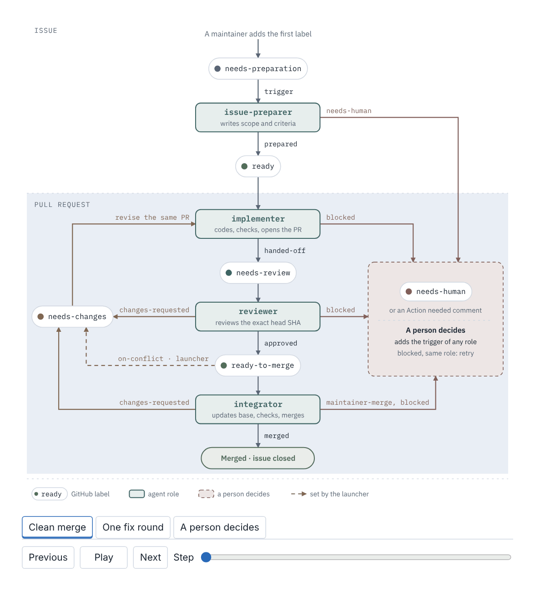
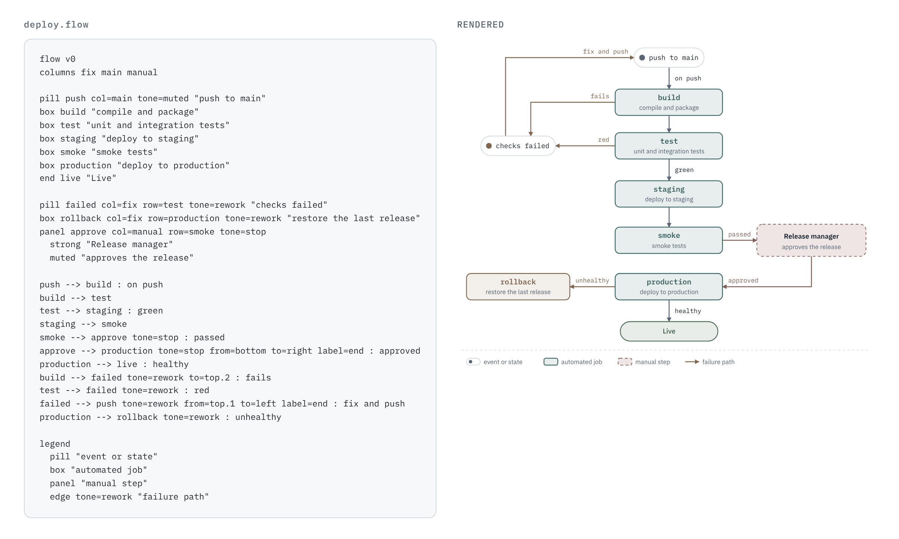
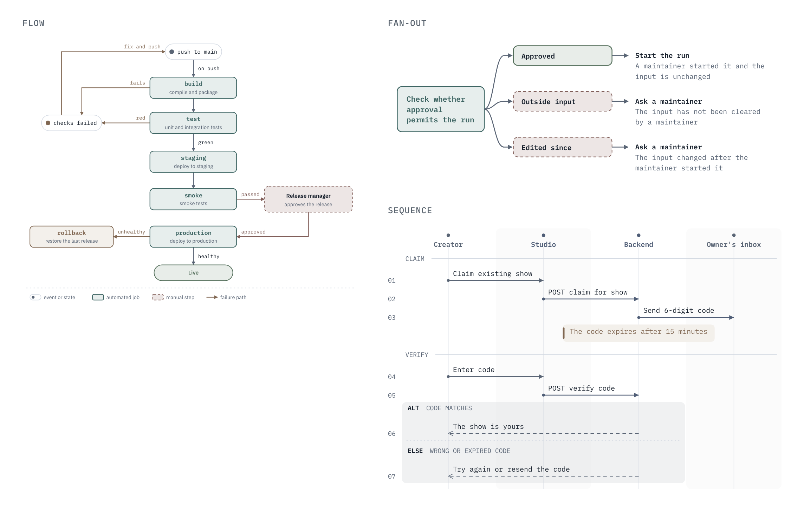
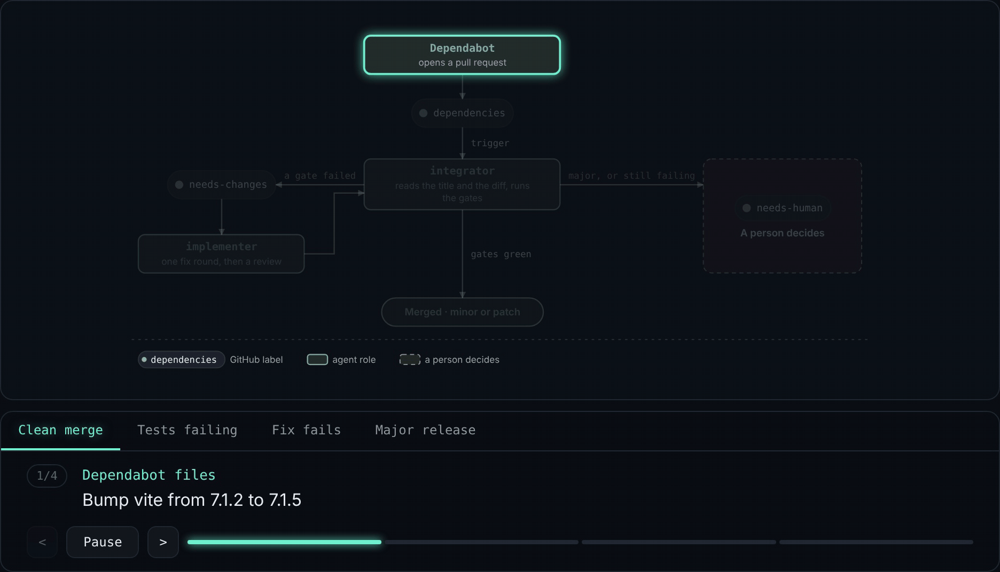

# ablauf

**Diagrams that agents write as text and people read as figures.**

[](https://www.npmjs.com/package/@uberblick/ablauf)
[](https://github.com/uberblick-ai/ablauf/blob/main/LICENSE)
[](https://nodejs.org)
[](https://github.com/uberblick-ai/ablauf/blob/main/package.json)
[](https://ablauf.uberblick.ai)

When an agent explains a process in a document, a diagram says it faster than
three paragraphs. But the agent can't see the picture it made, and with
automatic layout a one-line edit can move every box on the page.

ablauf is a small text format, and the renderer that draws it, for that case.
The author decides where each step sits and which side each edge leaves and
enters, the way they would draw the figure by hand. The text records those
decisions, so another agent can read and edit the diagram without looking at
it. The renderer sizes the grid and draws a themed SVG; it never moves anything,
and it reports every problem with its line number.

<picture>
  <source media="(prefers-color-scheme: dark)" srcset="https://raw.githubusercontent.com/uberblick-ai/ablauf/main/docs/images/playback-dark.gif">
  
</picture>

<sub>The <a href="https://github.com/uberblick-ai/ub-agents">ub-agents</a> delivery loop, played with the package's own controls. Source: <a href="https://github.com/uberblick-ai/ablauf/blob/main/spike/examples/loop-play.flow">spike/examples/loop-play.flow</a>.</sub>

## What you get

- **A layout you decide.** Nodes sit in named columns and rows, and each edge
  leaves and enters on the sides you pick. Insert a step and only what is
  below it moves down a row.
- **Problems an agent can check.** An edge through a node or two labels on top
  of each other is a diagnostic with a line number, not a silent fix. A diagram
  is done when the list is empty.
- **Three kinds.** Routed flows, outcome fan-outs and sequences of messages
  between participants, with more planned on the same grid.
- **Playback.** A `play` section walks a reader through a flow one step at a
  time, in several scenarios, with captions. The timeline travels in the same
  text, so it fits in a Markdown code block. Fan-out and sequence playback are
  planned.
- **Light and dark, and your colours.** Every SVG carries a quiet light and
  dark palette, follows the reader's theme, and takes host colours through
  `--ab-*` custom properties.
- **Deterministic and inert.** The same source gives the same SVG bytes. No
  scripts, no external URLs, all source text escaped, and no runtime
  dependencies.

## Text in, figure out

About thirty lines describe a deploy pipeline. `columns` names the columns,
each node starts a new row unless `row=` puts it beside another, and `from=`
and `to=` pick the sides an edge leaves and enters.

<picture>
  <source media="(prefers-color-scheme: dark)" srcset="https://raw.githubusercontent.com/uberblick-ai/ablauf/main/docs/images/source-dark.png">
  
</picture>

[spike/PRIMER.md](https://github.com/uberblick-ai/ablauf/blob/main/spike/PRIMER.md)
is the whole format on one page, and the page an agent reads before it writes
a diagram.

## Three kinds, one look

The first line of a diagram names its kind: `flow v0`, `fan-out v0` or
`sequence v0`. All three formats are v0.

<picture>
  <source media="(prefers-color-scheme: dark)" srcset="https://raw.githubusercontent.com/uberblick-ai/ablauf/main/docs/images/kinds-dark.png">
  
</picture>

A fan-out is one step and its ordered outcomes, each with a reason and a
destination:

```
fan-out v0
step "Check whether approval permits the run"

outcome "Approved" reason="A maintainer started it and the input is unchanged" destination="Start the run" tone="done"
outcome "Outside input" reason="The input has not been cleared by a maintainer" destination="Ask a maintainer" tone="stop"
outcome "Edited since" reason="The input changed after the maintainer started it" destination="Ask a maintainer" tone="stop"
```

A sequence puts participants on lifelines and messages in source order, with
flow's `-->` requests and `-.->` responses, notes, sections and `alt`/`else`
groups. See [all three kinds on the website](https://ablauf.uberblick.ai).

## Play it step by step



Add one or more `play` sections after a flow. Each step names a node and
lights it, together with the edges from the previous step's node.

```
play "One fix round"
  step implementer
  step needs-review
  step reviewer "Find a change that needs another pass"
  step needs-changes
  step implementer 2.4s "Revise the same pull request"
```

`render` returns the timelines beside the SVG. Mount the built-in scenario
tabs, buttons, step range and captions in an element or shadow root below
the inline SVG:

```ts
import { mountPlayback } from "@uberblick/ablauf/playback";

const mount = mountPlayback(controlsContainer, svgElement, result.timelines);
// Starts idle; the user presses Play. The host can also call mount.player.
// Before replacing the SVG or its timelines:
mount.destroy();
```

The figure starts idle and plays when the reader presses Play. A diagram
without a `play` section carries no playback markup.

<details>
<summary><b>Playback details and the headless player</b></summary>

The container can hold other host content. `mount.destroy()` and
`mount.player.destroy()` perform the same idempotent cleanup: stop playback,
clear highlighting, remove the mount's controls, style and listeners, and leave
host content intact. Destroy the old mount before rendering changed source,
then mount again. No timelines adds no controls or style. A single timeline
has no tabs; an empty scenario stays selected and shows “No playable steps”.
Tabs activate immediately on Left/Right (wrapping), click or Enter/Space;
selection pauses on the first step. The range includes the full figure at `-1`.
Controls follow the SVG's automatic or pinned scheme and accept host `--ab-*`
colour overrides on their container. `PlaybackMount` is exported from the same
entry. Both entries are safe to import without browser globals.

For custom controls, use the headless player:
For custom controls, use the headless player:

```ts
import { createPlayer } from "@uberblick/ablauf/playback";
import type { Timeline } from "@uberblick/ablauf";

export function attachPlayback(svg: SVGSVGElement, timelines: Timeline[]) {
  const player = createPlayer(svg, timelines, {
    onChange(state) {
      // The SVG and player.state already match this stable snapshot.
      console.log(state.scenario, state.step, state.status);
    },
  });
  return player;
}
```

Creation shows the full figure at `{ scenario: 0, step: -1, status: "idle" }`
without a timer or callback. Call `play()` from a host interaction to start;
`pause()` keeps the frame, and resuming restarts its full dwell. Each step,
including the last, stays current for its `ms`. Playback ends on the last
frame; `play()` replays it, or `{ loop: true }` loops the selected scenario.
Repeated `play()` during playback leaves the timer alone.

`next()`, `previous()` and `seek(step)` pause and clamp integer steps to
`-1..last`; `-1` clears highlighting. `select(scenario)` pauses on that
scenario's first step, including when reselecting it. Invalid scenario indices
and non-integer indices are ignored. Empty scenarios stay at step `-1`;
playing them stays idle. The player never chooses another scenario for you.

Reduced motion is checked through the SVG's window on every `play()` and
observed during playback. Enabling it resets to the full idle figure without
a timer. Disabling it never starts playback. Manual navigation still works.
The player adds no animations, transitions, controls or layout changes.

`onChange` fires once per changed scenario/step/status tuple, after the SVG
and `player.state` update. Call `destroy()` when removing a figure: it clears
timers, preference listeners and highlighting, silently returns to idle at
step `-1`, and makes later methods inert. Both package entries can be imported
in Node; only creating and using a player needs an SVG. `Player` and
`PlayerState` types are exported from the playback entry.

</details>

## Try it

The [website](https://ablauf.uberblick.ai) shows every kind with its source.
In a checkout, the playground puts an editor beside the live render, lists
each problem with its line number, switches between light and dark and between
a bare page and a 710 px document column, and opens every example in this
repository. With [mise](https://mise.jdx.dev):

```sh
mise trust && mise run setup
mise run playground
```

Then open http://localhost:4620.

## Render in a build script

Requires Node.js 22.18 or newer. The package ships compiled JavaScript and
TypeScript declarations, with no runtime dependencies or TypeScript loader
required. Its public entry point is an ES module.

Install it in your project:

```sh
npm install @uberblick/ablauf
```

Save this as `render-flow.mjs`:

```js
import { readFile, writeFile } from "node:fs/promises";
import { render } from "@uberblick/ablauf";

const [input, output] = process.argv.slice(2);
if (!input || !output) {
  console.error("Usage: node render-flow.mjs input.flow output.svg");
  process.exit(2);
}

const source = await readFile(input, "utf8");
const { svg, diagnostics } = render(source, {
  idPrefix: "build-flow",
  scheme: "light",
});
await writeFile(output, svg);

for (const { line, severity, message } of diagnostics) {
  console.error(`${input}:${line} ${severity}: ${message}`);
}
// Keep the SVG for inspection, but fail the build on any source problem.
process.exitCode = diagnostics.length ? 1 : 0;
```

Run it with a flow file and the desired output path:

```sh
node render-flow.mjs diagram.flow diagram.svg
```

`render(source, options?)` returns `{ svg, diagnostics, layout, timelines }`. Source
problems return diagnostics with one-based `line`, `severity` and `message`
fields while still producing SVG. Invalid caller options can throw.
`idPrefix` defaults to `"ab"`; supply distinct prefixes for diagrams sharing
a page. Omit `scheme` to follow the system theme, or pin it to `"light"` or
`"dark"`. The `fonts` option accepts host font families and synchronous width
metrics. Both fan-out styles use `fonts.mono` for all text and its layout;
`fonts.text` affects flow text only. Omitting `fonts` or supplying `{}` keeps
the default SVG bytes. See [host fonts and width metrics](https://github.com/uberblick-ai/ablauf/blob/main/docs/plan.md#host-fonts-and-width-metrics).
TypeScript consumers can import `RenderOptions`, `Diagnostic`, `FontOptions`,
`FontsOptions` and `TextStyle` from the same entry point. `LIGHT` and `DARK`
export the default palettes.

## How it relates to Mermaid

We started with Mermaid, and the first version of ablauf was a Mermaid
subset. Mermaid lays a diagram out automatically, which makes it quick to
write, and it covers far more diagram types. For the documents we work on we
wanted the author to decide where each step sits and which side each edge
leaves and enters, so that a small edit to the text leaves the rest of the
picture where it was.

The arrow and label notation (`-->`, `-.->`, `: label`) is familiar from
Mermaid, because agents already know that spelling. Sequence shares flow's
`-->` requests and `-.->` responses rather than Mermaid's sequence arrow
aliases.

## What it isn't

- **Not automatic layout.** You place every node. If you want the tool to
  decide, an automatic layout engine will serve you better.
- **Not Mermaid-compatible.** There is no import or export. If you need
  Mermaid's breadth of diagram types, Mermaid is the better choice.
- **Young.** All three formats are v0, and playback covers flows only so far.
  The [changelog](https://github.com/uberblick-ai/ablauf/blob/main/CHANGELOG.md) records what changes.

The [motivation page](https://ablauf.uberblick.ai/motivation) has the longer
story.

## More examples

<details>
<summary><b>The deploy pipeline as text you can copy, with the format explained</b></summary>

```
flow v0
columns fix main manual

pill push col=main tone=muted "push to main"
box build "compile and package"
box test "unit and integration tests"
box staging "deploy to staging"
box smoke "smoke tests"
box production "deploy to production"
end live "Live"

pill failed col=fix row=test tone=rework "checks failed"
box rollback col=fix row=production tone=rework "restore the last release"
panel approve col=manual row=smoke tone=stop
  strong "Release manager"
  muted "approves the release"

push --> build : on push
build --> test
test --> staging : green
staging --> smoke
smoke --> approve tone=stop : passed
approve --> production tone=stop from=bottom to=right label=end : approved
production --> live : healthy
build --> failed tone=rework to=top.2 : fails
test --> failed tone=rework : red
failed --> push tone=rework from=top.1 to=left label=end : fix and push
production --> rollback tone=rework : unhealthy

legend
  pill "event or state"
  box "automated job"
  panel "manual step"
  edge tone=rework "failure path"
```

- `columns` names the columns left to right. Each node starts a new row unless
  `row=` puts it beside another node.
- Nodes are `text`, `pill`, `box`, `end`, `panel` or `decision`, coloured by a tone.
- Edges use the familiar arrow notation. `from=` and `to=` pick the sides an
  edge leaves and enters; each pair of sides has one fixed shape.
- `legend` explains the shapes in fine print under the diagram.

For phone widths, [author separate wide and narrow layouts](https://github.com/uberblick-ai/ablauf/blob/main/docs/narrow-layouts.md).
The worked pair keeps the same content and lets the host select a readable SVG.

</details>

<details>
<summary><b>An online order, the ub-agents loop, a classic flowchart, a fan-out and a sequence</b></summary>

#### An online order

From [spike/examples/checkout.flow](https://github.com/uberblick-ai/ablauf/blob/main/spike/examples/checkout.flow), with two
sections:

<picture>
  <source media="(prefers-color-scheme: dark)" srcset="https://raw.githubusercontent.com/uberblick-ai/ablauf/main/docs/images/checkout-dark.svg">
  
</picture>

#### The ub-agents delivery loop

The loop [ub-agents](https://github.com/uberblick-ai/ub-agents) runs on
Uberblick's repositories, from
[spike/examples/loop.flow](https://github.com/uberblick-ai/ablauf/blob/main/spike/examples/loop.flow):

<picture>
  <source media="(prefers-color-scheme: dark)" srcset="https://raw.githubusercontent.com/uberblick-ai/ablauf/main/docs/images/loop-dark.svg">
  
</picture>

#### A classic flowchart

`decision` asks a question over a small diamond, and `label=inline` sets each
answer into a gap in its edge. From
[spike/examples/project-workflow.flow](https://github.com/uberblick-ai/ablauf/blob/main/spike/examples/project-workflow.flow):

<picture>
  <source media="(prefers-color-scheme: dark)" srcset="https://raw.githubusercontent.com/uberblick-ai/ablauf/main/docs/images/project-workflow-dark.svg">
  
</picture>

#### An outcome fan-out

<picture>
  <source media="(prefers-color-scheme: dark)" srcset="https://raw.githubusercontent.com/uberblick-ai/ablauf/main/docs/images/approvals-dark.svg">
  
</picture>

#### Claim your podcast

Sequence (`sequence v0`) puts participants on ordered lifelines and messages
in source order. It uses flow's `-->` requests and `-.->` responses with
`: label` text. The
[claim example](https://github.com/uberblick-ai/ablauf/blob/main/spike/examples/claim-short.flow)
has Claim and Verify sections, a note about code expiry and an `alt`/`else`
group for the two verification outcomes. A longer
[annotated version](https://github.com/uberblick-ai/ablauf/blob/main/spike/examples/claim.flow)
adds an RSS feed and the full handshake.

<picture>
  <source media="(prefers-color-scheme: dark)" srcset="https://raw.githubusercontent.com/uberblick-ai/ablauf/main/docs/images/claim-short-dark.svg">
  
</picture>

</details>

## Host page themes

Inline SVGs can follow a page's `data-theme="light"` / `data-theme="dark"`
switch through the existing `--ab-*` CSS properties, without rerendering.
See [host page themes](https://github.com/uberblick-ai/ablauf/blob/main/docs/theming.md) for the complete base and tone palette,
copyable host CSS and the difference between inline SVG and image embedding.
Use the exported `TOKENS`, `Token`, `Palette` and `checkPalette` paint contract
to [test your integration](https://ablauf.uberblick.ai/guides/testing).

## Built for Uberblick

ablauf's first consumer is [Uberblick](https://uberblick.ai), a knowledge base
for people and agents, which shows a ```` ```ablauf ```` code block in a page as
a figure. Rendering well inside those documents, in light and dark, is the one
hard requirement. ablauf itself is independent and MIT licensed.

## Develop

You need [mise](https://mise.jdx.dev). In a fresh checkout or worktree:

```sh
mise trust && mise run setup
```

| Command | What it does |
| --- | --- |
| `mise run setup` | Installs the pinned Node and pnpm and the locked dependencies. |
| `mise run playground` | Serves the review page at http://localhost:4620 (another port if that one is busy). Open `#examples/loop` to see the loop beside its hand-drawn reference. |
| `mise run check FILE` | Renders one `.flow` file to an `.svg` beside it and lists its problems with line numbers. |
| `mise run render` | Renders every example to `spike/out/` and refreshes the SVG figures in this README. |
| `mise run media` | Captures the README's PNG and GIF figures in light and dark; needs Playwright with Chromium, ImageMagick and IBM Plex fonts. |
| `mise run site` | Builds [ablauf.uberblick.ai](https://github.com/uberblick-ai/ablauf/blob/main/site/README.md) into `site/out/`; `mise run site-serve` serves it. |
| `mise run measure` | Shows what moved between the loop and the loop with a role inserted. |
| `mise run ci` | Lint, typecheck and tests, before you push. |

`pnpm build` emits the package into `dist/`. `npm pack` builds it automatically.
The tests in `mise run ci` install the actual tarball with production dependencies
only in an isolated directory and exercise the public import and this build script.

`mise tasks` lists everything. The plan is in [docs/plan.md](https://github.com/uberblick-ai/ablauf/blob/main/docs/plan.md), and
the spike's results in [spike/FINDINGS.md](https://github.com/uberblick-ai/ablauf/blob/main/spike/FINDINGS.md).

Maintainers release an already-prepared version with `mise run release X.Y.Z`.
Start with `mise run release X.Y.Z --check`; see [releases](https://github.com/uberblick-ai/ablauf/blob/main/docs/releases.md)
for trusted-publishing setup, confirmation and partial-release recovery.

The earlier Mermaid-subset version lives in
[uberblick-ai/old-ablauf](https://github.com/uberblick-ai/old-ablauf).

Report vulnerabilities privately as [SECURITY.md](https://github.com/uberblick-ai/ablauf/blob/main/SECURITY.md) describes, not in an issue.

## License

MIT
