# Authoring for phone widths

Author a wide and a narrow `.flow` when one layout cannot serve both a document
column and a phone. Render both and let the host choose an SVG. Each source
records its own placement and routes, following the
[layout model](plan.md#who-decides-what).

## A worked pair

- [approval-wide.flow](../spike/examples/approval-wide.flow) puts the human
  decision panel beside the checks on the main path.
- [approval-narrow.flow](../spike/examples/approval-narrow.flow) stacks every
  node in one column, with the human decision panel between the checks and the
  final state. The direct `passed` edge goes around the panel on the right.

Both say the same thing: ready triggers checks; passed checks finish; blocked
checks need a person to resolve the blocked check, then a cleared decision
finishes. They preserve all node ids, kinds, labels, subtitles, tones, panel
lines, edge directions and labels, and legend entries. Only declaration order,
columns, rows and edge sides change. A panel's position in the stack does not
make it a required step: the arrows still distinguish the two paths.

From the repository root, render the pair with the existing tooling:

```sh
mise run render
```

This writes [approval-wide.svg](../spike/out/approval-wide.svg) and
[approval-narrow.svg](../spike/out/approval-narrow.svg) alongside the other
generated examples, and reports diagnostics. To iterate on just one source:

```sh
mise run check spike/examples/approval-narrow.flow
mise run check spike/examples/approval-wide.flow
```

`check` writes an SVG beside its `.flow`; `render` refreshes the files in
`spike/out/` used by the host below. Ship both refreshed SVGs together.

The complete narrow SVG is **277 × 404 CSS px**, including edge labels, the
outside route and the wrapped legend. It fits a 400 CSS px content area with
its natural 11–13 px text sizes. The wide SVG is **487 × 308 CSS px**. Keep
images at intrinsic width: `width: 100%` would stretch them, and scaling a wide
figure down would shrink its text. The example's `max-width: 100%` is a guard
for smaller spaces; below 277 px even this narrow figure would scale down.

## A copyable host

[Open the complete HTML example](narrow-layout.html) through a static server
at the repository root, or open the file locally. Its figure and CSS are:

```html
<style>
  .approval-flow { margin: 0; }
  .approval-flow img { display: block; max-width: 100%; height: auto; }
</style>
<figure class="approval-flow">
  <picture>
    <source media="(min-width: 600px)" srcset="../spike/out/approval-wide.svg">
    
  </picture>
  <figcaption>Automated checks with a path for a human decision.</figcaption>
</figure>
```

Paths above are relative to `docs/`; copy both SVGs to your host and adjust the
paths. Include `<meta name="viewport" content="width=device-width, initial-scale=1">`
in the page head so a phone uses its CSS viewport width. The `img` supplies one
accessible description of both layouts, including the branch relationships;
the caption names the figure. No JavaScript is needed.

The **600 CSS px viewport breakpoint** is a host choice. This example has
16 px padding on each side and a content width capped at 710 px, so at the
breakpoint the wide figure has 568 px available. At a 400 px viewport the
narrow figure has 368 px available and still uses its natural size. Below
600 px, including exactly 400 px, the narrow source is selected. From 600 px
up, the wide source is selected. A host with a sidebar or different gutters
must choose a breakpoint that leaves at least 487 px for this wide SVG; the
media query measures the viewport, not the figure's container.

Both SVGs contain light and dark palettes and follow `prefers-color-scheme`.
The complete host declares `color-scheme: light dark` and matches its page
background and text to that preference. If your host has a manual theme switch,
set its CSS `color-scheme` to the selected scheme so embedded SVGs use it too.
Host `--ab-*` custom properties do not cross an `` boundary; use inline
SVG if those overrides are needed.

## Keeping the pair equivalent

Edit both sources in the same change. Compare nodes by id, including panel
content and tones, and edges by source, target, direction, label, tone and
dashing. Keep the same legend meanings. Change only placement and routing;
shortening or omitting labels in the narrow variant changes the content.
Long panel text can wrap; other long labels may require a different authored
layout. A single column alone does not guarantee a narrow SVG, because outside
routes, edge labels and legend entries also contribute to its bounds.

Run `mise run ci` and `mise run render`; both variants must have zero diagnostics.
The pair's test guards content equivalence and the 400 px natural-width limit.
Check the complete host at 400 px, just below 600 px, and at 600 px in both
themes: source selection, natural text size, full legend, edge labels, no
horizontal scrolling and no clipping. Repeat after changing content or routes.
For human figure review, use `mise run playground` and open
`#examples/approval-wide` and `#examples/approval-narrow` in light and dark,
following the [standard review policy](../.agents/ub_agents.md#checks).
