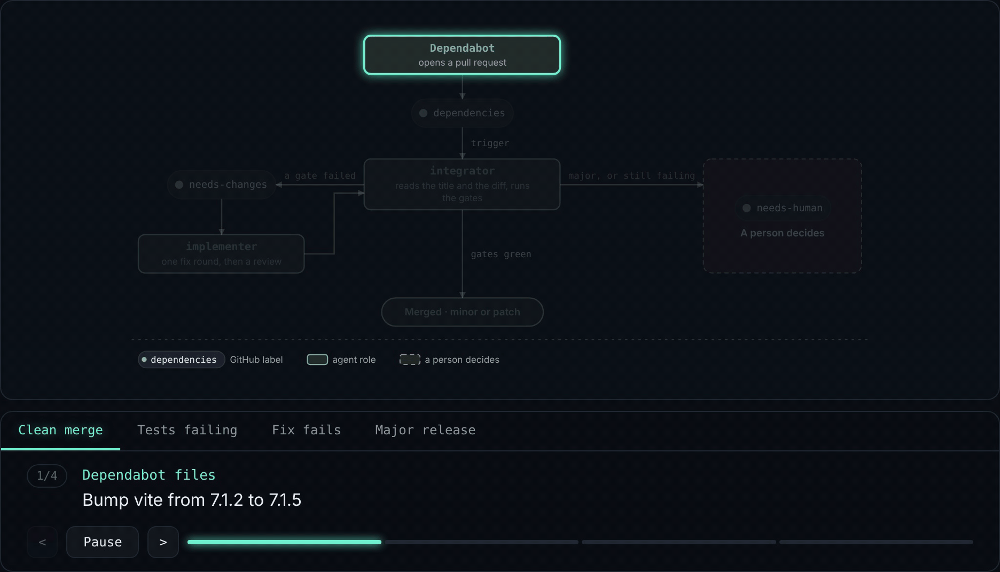

# Workflow gallery prototype

A one-file prototype of a workflow gallery built on this spike's playback. It shows
what playback should look like in a real page. Open `index.html` in a browser:
it needs no server and no build.



## What it shows

- **The wall:** cards whose diagrams play while they are in view, each cycling
  through its scenarios.
- **An entry:** one big diagram with scenario tabs ("Clean merge", "Tests
  failing", …). Every tab lights a different path through the same diagram.
  Underneath are the current step's actor and caption, previous / Pause / next
  controls, and a step bar.
- **The effects playback should ship with:**
  - parts that haven't played yet fade back;
  - the current step glows;
  - the edge just taken runs with dashes;
  - played parts keep a quiet outline;
  - fades ease in and out;
  - reduced motion turns the motion off.

## Where the effects live

The effect CSS is at the top of the page styles in `gen.mjs` (the `.ab` rules
after `--ab-play`). The running-dash rule and its keyframes come from
`spike/flow/svg.ts`, so the SVG carries them itself. The player is
`spike/flow/player.ts`, inlined unchanged.

Only these belong in the page rather than in ablauf: the wall's cycling and
play-in-view behaviour, the "All steps" list and the URL for each scenario.

## Rebuild

```sh
node spike/gallery/gen.mjs > spike/gallery/index.html
node spike/gallery/record-gif.cjs   # needs playwright and ffmpeg
```

`scenarios.mjs` holds the steps and captions for each diagram, and `about.mjs`
holds the copy for each entry. The diagrams are the `.flow` files in
`spike/play/`. The captions are illustrative, not from real runs.
